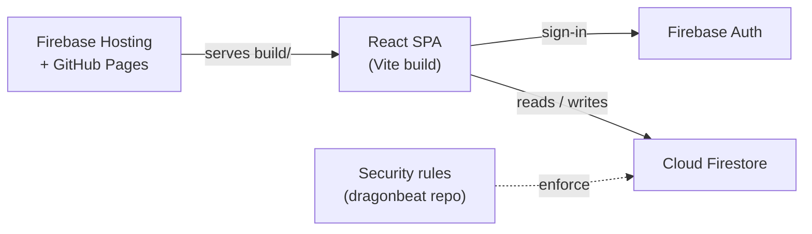
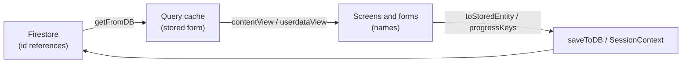

# Architecture

Training Planner is a client-only React single-page app backed by Firebase.
There is no app server: the browser talks to Firebase Auth and Firestore
directly, and access is enforced by Firestore security rules.



## External interfaces and dependencies

| Dependency | Used for |
| --- | --- |
| Firebase Auth | Email/password and Google sign-in |
| Cloud Firestore | All app data (see [Data model](#data-model)) |
| Firebase Hosting / GitHub Pages | Serving the static build (see [DEPLOYMENT.md](DEPLOYMENT.md)) |
| `@dyordsabuzo/ui-components` | Shared UI library (GitHub Packages, needs `PACKAGES_READ_TOKEN`) |
| `@tanstack/react-query` | Data fetching and caching, persisted to IndexedDB |

**Firestore security rules are not in this repo.** They live in the
[`dragonbeat`](https://github.com/dyordsabuzo/dragonbeat) repo, which also
holds the Regatta app's rules for the same Firebase project
(`training-planner-387200`) and deploys them from CI. Never deploy rules from
here.

## Source layout

| Path | Contents |
| --- | --- |
| `src/context/` | App state providers: auth, settings, content (`SourceDataContext`), the running session (`SessionContext`), user management |
| `src/pages/` | Routed screens: home, training flow (`train/`, `timer/`), history, sharing |
| `src/management/` | Admin "Manage" screens: listings, relationship map, users |
| `src/forms/` | Create/edit forms for exercises, supersets, sessions, plans, users |
| `src/common/` | Pure helpers: Firestore access (`utils.ts`), references (`refs.ts`), plan cycles, stats, caching |
| `src/routes/` | Route table and app shell |
| `functions/` | Cloud Functions (scaffold for the multi-tenant work; no functions yet) |
| `scripts/` | One-off Admin SDK data migrations |

Providers are nested in `src/App.tsx`: Theme → Sidebar → Auth → AppSettings →
Session → SourceData → UserManagement → routes.

## Data model

Content is a hierarchy: **plan → sessions → supersets / exercise groups →
exercises**.

| Collection | Doc | Key fields |
| --- | --- | --- |
| `exercises` | one per exercise | `name`, `supersets[]`, `alternatives[]`, targets |
| `supersets` | one per superset | `name`, `exercises[]`, `sessions[]`, targets |
| `sessions` | one per session | `name`, `supersets[]`, `groups[]` (inline exercise groups, each with a stable `id`), share snapshot |
| `plans` | one per plan | `name`, `sessions[]`, `weeks{}`, cycle settings |
| `users` | `users/{uid}` | `role` (`admin` / `user`), `plans[]` (granted plan ids), profile |
| `userdata` | `userdata/{uid}` | logged progress, plus `inProgress` for a run underway |
| `settings` | `settings/app` | admin contact email, `contentVersion` |

### References are ids, the UI uses names

Every reference between content items, and every key in logged progress, is
stored as a **Firestore doc id** (exercise groups use their stable group id).
Renaming an item therefore never breaks a reference or orphans history.

The UI works with names. `src/common/refs.ts` is the single translation
point:



- `SourceDataContext` reads the stored caches and exposes a name view.
  Content saves go through `toStoredEntity`.
- `SessionContext` writes progress with keys converted by `progressKeys`. Each
  finished run also saves `meta.labels` (id → name), so history can still
  name items that were since deleted.
- Lookups pass unknown values through and also match a name an item used to
  have (`previousNames`), so data saved before the id migration
  (`scripts/migrate-ids.ts`) still reads correctly.

Names stay unique within a collection (`src/common/nameValidation.ts`), which
keeps the mapping exact.

### Progress shape

```
userdata/{uid}
  {planId}
    {week}            "Week 1" ... or "Open" for open plans
      {sessionId}
        {unitId}      superset id or exercise-group id
          {exerciseId}
            {set}     { targetRep, targetWeight, ... }
        mood, meta { completedAt, startedAt, labels }
  inProgress { plan, week, session, data }
```

## Access model

- Signed-in users can read exercises, supersets and sessions.
- Plans are readable by admins, or by users whose `users/{uid}.plans` include
  the plan's id. Non-admins query plans by `documentId() in` their grants.
- A user reads and writes only their own `userdata/{uid}`. Admins can read it
  for the read-only "View as" troubleshooting mode.
- Only admins write content, users' roles and grants, and settings.
- A shared session (`isShareable`) opens without signing in, through its
  self-contained `sharedSnapshot`.

## Caching and offline use

- React Query keeps fetched data in IndexedDB for up to 7 days
  (`src/common/queryCache.ts`), so the app opens instantly and works offline.
- Content queries never go stale on their own. Each admin edit writes a new
  `settings/app.contentVersion`, and clients refetch content only when that
  value changes. This costs no extra reads, since `settings/app` is read at
  startup anyway.
- The cache is cleared on sign-out. Bump `CACHE_BUSTER` whenever the cached
  data's shape changes.
