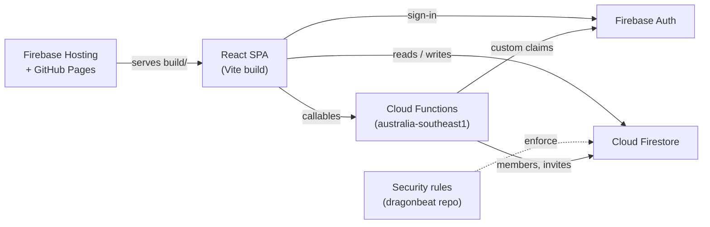
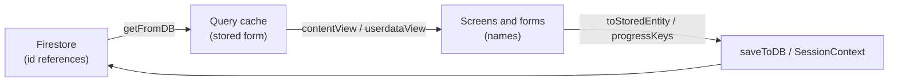

# Architecture

Training Planner is a client-only React single-page app backed by Firebase.
The browser talks to Firebase Auth and Firestore directly, and access is
enforced by Firestore security rules. Callable Cloud Functions handle the few
writes the client may not make itself: creating orgs, invites and
memberships, and setting the custom claims the rules check.



## External interfaces and dependencies

| Dependency | Used for |
| --- | --- |
| Firebase Auth | Email/password and Google sign-in |
| Cloud Firestore | All app data (see [Data model](#data-model)) |
| Cloud Functions | Org, invite and membership management; custom claims (see [Organisations](#organisations)) |
| Firebase Hosting / GitHub Pages | Serving the static build (see [DEPLOYMENT.md](DEPLOYMENT.md)) |
| `@dyordsabuzo/ui-components` | Shared UI library (GitHub Packages, needs `PACKAGES_READ_TOKEN`) |
| `@tanstack/react-query` | Data fetching and caching, persisted to IndexedDB |

**Firestore security rules are not in this repo.** They live in the
[`dragonbeat`](https://github.com/dyordsabuzo/dragonbeat) repo, which also
holds the Regatta app's rules for the same Firebase project
(`training-planner-387200`) and deploys them from CI. Never deploy rules from
here.

## Source layout

| Path | Contents |
| --- | --- |
| `src/context/` | App state providers: auth, settings, content (`SourceDataContext`), the running session (`SessionContext`), user management |
| `src/pages/` | Routed screens: home, training flow (`train/`, `timer/`), history, sharing |
| `src/management/` | Admin "Manage" screens: listings, relationship map, users |
| `src/forms/` | Create/edit forms for exercises, supersets, sessions, plans, users |
| `src/common/` | Pure helpers: Firestore access (`utils.ts`), references (`refs.ts`), plan cycles, stats, caching |
| `src/routes/` | Route table and app shell |
| `functions/` | Callable Cloud Functions for orgs, invites, members and claims |
| `scripts/` | One-off Admin SDK data migrations |

Providers are nested in `src/App.tsx`: Theme → Sidebar → Auth → AppSettings →
Session → SourceData → UserManagement → routes.

## Data model

Content is a hierarchy: **plan → sessions → supersets / exercise groups →
exercises**.

| Collection | Doc | Key fields |
| --- | --- | --- |
| `orgs/{orgId}/exercises` | one per exercise | `name`, `supersets[]`, `alternatives[]`, targets |
| `orgs/{orgId}/supersets` | one per superset | `name`, `exercises[]`, `sessions[]`, targets |
| `orgs/{orgId}/sessions` | one per session | `name`, `supersets[]`, `groups[]` (inline exercise groups, each with a stable `id`), share snapshot |
| `orgs/{orgId}/plans` | one per plan | `name`, `sessions[]`, `weeks{}`, cycle settings, `personalisedFor` (client uid, on a personalised copy) |
| `users` | `users/{uid}` | profile and access request |
| `userdata` | `userdata/{uid}` | `inProgress` for a run underway |
| `userdata/{uid}/plans` | `plans/{planId}` | `orgId` of the plan, plus that plan's logged progress |
| `settings` | `settings/app` | admin contact email |
| `settings` | `settings/platform` | billing guard state: `functionsSuspended`, `costAmount`, `allowedCost` |
| `orgs` | `orgs/{orgId}` | `name`, `code`, `ownerUid`, `status` (`active` / `suspended`), `contentVersion` |
| `orgs/{orgId}/members` | `members/{uid}` | `uid`, `role` (`owner` / `trainer` / `client`), `assignedPlanIds[]`, `trainerUids[]` (clients), `email`, `displayName` |
| `orgs/{orgId}/invites` | `invites/{token}` | `role`, `expiresAt`, `usesLeft` |
| `orgs/{orgId}/public` | `public/profile` | `name`, `contentVersion`, readable by anyone signed in (for orgs linking to this org's items) |
| `orgs/{orgId}/links` | `links/{linkId}` | `srcOrgId`, `collection`, `srcId`, `linkedAt`, `linkedBy`: a live link to another org's item |

All four content collections also carry the sharing fields `visibility`
(`private` / `orgs` / `public`, missing means private), `sharedWithOrgIds[]`
and `sharedWithOrgs[]` (`{id, name, code}`, for display), and, once shared:
`source` (`{orgId, id, mode, copiedAt}` on a copy), `linkCount` (how many
other orgs link to it, kept by Cloud Functions) and `archived`. See
[Sharing library items](#sharing-library-items).

Before orgs, content lived in top-level collections and roles in
`users/{uid}.role` / `plans[]`. `scripts/migrate-orgs.ts` copied it all into
`orgs/default`, and `scripts/cleanup-top-level.ts` removes the old copies
and fields.

### References are ids, the UI uses names

Every reference between content items, and every key in logged progress, is
stored as a **Firestore doc id** (exercise groups use their stable group id).
Renaming an item therefore never breaks a reference or orphans history.

The UI works with names. `src/common/refs.ts` is the single translation
point:



- `SourceDataContext` reads the stored caches and exposes a name view.
  Content saves go through `toStoredEntity`.
- `SessionContext` writes progress with keys converted by `progressKeys`. Each
  finished run also saves `meta.labels` (id → name), so history can still
  name items that were since deleted.
- Lookups pass unknown values through and also match a name an item used to
  have (`previousNames`), so data saved before the id migration
  (`scripts/migrate-ids.ts`) still reads correctly.

Names stay unique within a collection (`src/common/nameValidation.ts`), which
keeps the mapping exact.

### Progress shape

```
userdata/{uid}
  inProgress { plan, week, session, data }
userdata/{uid}/plans/{planId}
  orgId               org the plan belongs to (never changes)
  {week}              "Week 1" ... or "Open" for open plans
    {sessionId}
      {unitId}        superset id or exercise-group id
        {exerciseId}
          {set}       { targetRep, targetWeight, ... }
      mood, meta { completedAt, startedAt, labels }
```

Each plan's progress is its own doc, tagged with its org, so a trainer can
read a client's progress for their org only. The app reads the active org's
plan docs (`where orgId ==`) and `assembleUserdata` (`refs.ts`) joins them
with `inProgress` into the single-doc shape the screens use. Before Phase 3a
all of this lived in `userdata/{uid}`; `scripts/split-userdata.ts` moved it.

## Access model

Everything is scoped to the user's **active org** (see
[Organisations](#organisations)). In the UI, an owner or trainer of the
active org has the `admin` role and a client has `user`
(`AuthContext.tsx`, from `useOrgMembership.ts`).

- Members of the org can read its exercises, supersets and sessions.
- Trainers see every plan. Clients query plans by `documentId() in` their
  member doc's `assignedPlanIds`.
- A user reads and writes only their own progress. A new plan doc must be
  tagged with an org they belong to, and its `orgId` can't change.
- Owners and trainers of an org can read (never write) their clients' plan
  docs tagged with that org. A list must filter on `orgId`. The root
  `userdata/{uid}` (`inProgress`) stays private to the user and the platform
  admin.
- "View as" shows the app as a member sees it, read-only. It uses the same
  per-org progress read, so it works for any trainer of the org.
- Trainers write content. Roles and plan assignments change only through
  Cloud Functions. App settings are for the platform admin.
- Content shared beyond the org is read-only to others: public items to
  anyone signed in, `orgs` items to every member of the listed orgs.
- An item other orgs link to (`linkCount > 0`) can't be deleted, only
  archived, and only Cloud Functions change `linkCount`. Members read their
  org's `links`; only Cloud Functions write them. Any signed-in user reads an
  org's `public/profile`, and its trainers bump only its `contentVersion`.
- A shared session (`isShareable`) opens without signing in, through its
  self-contained `sharedSnapshot`. Share links are
  `/training-planner/share/{orgId}/{sessionId}`. Older links without an org
  id open from `orgs/default`.

### Organisations

Each user's ID token carries a custom claim `orgs: {[orgId]: role}` (and
`superAdmin` for platform admins). Only `functions/src/claims.ts` sets it,
rebuilding it from the user's member docs whenever a membership changes.
Suspended orgs are left out. The app reads the claim on sign-in, refreshing
the token once if it has no orgs yet. It remembers the active org on the
device, and the profile menu offers a switcher when there is more than one.
Home also shows which org's plans are on screen, with one-tap buttons for
the others.
Under `orgs/{orgId}`:

How people get into an org:

- **Trainers** start their own from Home ("Start my organisation", which
  calls `createOrg`). Anyone signed in who isn't in an org sees it.
- **Clients and trainers** join through an invite link (with a QR code) made
  on the Clients screen: `/training-planner/join/{orgId}/{token}`
  (`acceptInvite`). Trainers can invite clients; only the owner invites
  trainers.
  A link opened while signed out is remembered, and Home returns to it
  after sign-in or sign-up.
- **The platform admin** can still add an existing account that asked for
  access (`addMember`, from the Clients screen).

Rules under `orgs/{orgId}`:

- Members read exercises, supersets and sessions. Owners and trainers write them.
- Clients read only the plans in their member doc's `assignedPlanIds`.
- Members and invites are written only by Cloud Functions. Owners change
  roles and assign trainers to clients. Trainers invite clients and assign
  plans. Anyone signed in can create an org.

| Callable | Who | Does |
| --- | --- | --- |
| `createOrg` | any signed-in user | creates an org, caller becomes `owner` |
| `findOrgByCode` | owner or trainer of any org | `{id, name, code}` of the active org with that code, to share with it |
| `listLibrary` | owner, trainer | items shared with the org, or public ones, with their owner org's name |
| `copyToOrg` | owner, trainer of the target org | copies a shared item and everything it uses into the org |
| `linkToOrg` | owner, trainer of the target org | links a shared exercise, superset or session, and everything it uses |
| `convertLinkToCopy` | owner, trainer | replaces a link (and links to what it uses) with copies under the same ids |
| `unlink` | owner, trainer | removes a link that nothing in the org uses |
| `createInvite` | owner (any role), trainer (`client` only) | invite token (expiry, max uses) |
| `acceptInvite` | any signed-in user | joins the org with the invite's role |
| `addMember` | owner | adds an existing account as `trainer` or `client` (used by the Users screen) |
| `setMemberRole` | owner | `trainer` ↔ `client` |
| `removeMember` | owner, or the member themselves | removes the membership |
| `setAssignedPlans` | owner, trainer | sets a member's `assignedPlanIds` |
| `setClientTrainers` | owner | sets a client's `trainerUids` (each must be a trainer or the owner) |
| `suspendOrg` | super admin | suspends or reactivates an org |

`billingGuard` isn't callable. It runs on Cloud Billing budget notifications
and closes the callables to the public once the project starts costing
money (see [DEPLOYMENT.md](DEPLOYMENT.md#cost-controls)). The app reads
`settings/platform.functionsSuspended` and shows "temporarily unavailable"
on the Clients screen instead of calling them.

### Trainers managing clients

- **Clients screen** (`/training-planner/admin`, `UserListing.tsx`): the
  active org's roster, filtered to Clients (optionally "My clients", from
  `trainerUids`), Trainers or All. Edit changes role, plans and, for the
  owner, a client's trainers (`UserForm.tsx`).
- **Client page** (`/training-planner/admin/clients/{uid}`,
  `ClientDetailPage.tsx`): assigned plans with progress (done and overdue
  sessions for open plans, completed sessions otherwise), recent sessions
  (`HistoryRunList.tsx`, read-only) and a "View as" shortcut. Progress comes
  from `useClientUserdata` (`SourceDataContext.tsx`), which shares the cache
  with "View as".
- **Personalise** (client page): copies an assigned plan and its sessions
  for that client (`personalisePlan` in `cloneEntity.ts`, saved by
  `SourceDataContext`), names them "… (Client)", tags the plan copy with
  `personalisedFor`, and assigns it in place of the original. Supersets and
  exercises stay shared. Sessions already logged stay with the original plan.
- Assigning trainers only labels the roster. Every trainer of the org can see
  every client.

### Sharing library items

Phase 4a of the multi-tenant plan: an item's owners and trainers choose who
else can see it, from **Visibility…** in its ⋮ menu (`VisibilityModal.tsx`,
via `EntityActions`). Shared items show a globe (public) or group icon.

- **Private** (default): only the org.
- **Specific orgs**: added by their org code (`findOrgByCode`). There is no
  directory of orgs.
- **Public**: any signed-in user, for the marketplace.
- "Also share the N items it uses" applies the same setting to everything the
  item depends on (`dependenciesOf` in `refs.ts`: plan → sessions →
  supersets and group exercises → exercises → alternatives). A dependency's
  access is only ever widened (`widenSharing` in `common/sharing.ts`).
- `setSharing` (`SourceDataContext`) writes only the sharing fields, in one
  batch, and bumps the org's `contentVersion`.
- A plan personalised for a client (`personalisedFor`) is never shared. The
  menu hides the action and the rules reject it.
- Rules (dragonbeat `tpSharedRead` / `tpValidSharing`) allow direct reads of
  shared items and the collection-group "marketplace" query
  (`visibility == "public"`). They can't prove a "shared with my orgs" list
  query, so the Library lists come from a Cloud Function (below).
- The public share page (`isShareable`) is separate and unchanged.

### Library and copying

**Manage → Library** (`LibraryBrowser.tsx`) has two views: **Shared with
me** and **Marketplace** (public). Both come from `listLibrary`, which runs
the collection-group queries server-side and adds each owner org's name,
since other orgs' docs aren't readable from the app. You can search by name,
tag or org, and filter by type.

**Copy to my org** calls `copyToOrg` (`functions/src/library.ts`, with pure
helpers in `functions/src/sharing.ts`):

- It copies the item and everything it uses, including dependencies the
  owner left private, because the item is unusable without them.
- Each copy gets the id `x_{srcOrgId}_{srcId}` (`copyId`), so copying again
  reuses what an earlier copy created instead of duplicating it.
- References are remapped to the copies, and references to deleted items
  are dropped. Back-links (`exercise.supersets`, `superset.sessions`) are
  kept only within the copied set. An item copied earlier gains back-links
  to the new copies that use it.
- Share and history fields (`visibility`, `isShareable`, `sharedSnapshot`,
  `previousNames`, `personalisedFor`, ...) are stripped. Each copy records
  `source: {orgId, id, mode: "copy", copiedAt}`.
- A name the org already uses becomes "… (copy)".
- It writes everything in one batch and bumps the org's `contentVersion`.
  The app then refetches its content (`reloadContent`).
- Editing a copy never touches the original.

### Live links

**Link** in the Library (`linkToOrg`) uses another org's exercise, superset
or session read-only, following its owner's edits. Plans can only be copied,
because clients are assigned plans by id.

- Linking an item links everything it uses too. Each linked item gets a
  link doc `orgs/{orgId}/links/{linkId}`, and its source item's `linkCount`
  goes up. The link id is the id a copy would get (`copyId`), and the org's
  own sessions and plans reference that id.
- Everything it uses must be shared with the org, because its members (and
  their clients) read the items directly from the owner's org. Otherwise the
  call names what's missing: "Ask Org A to also share: …".
- **In the app** (`SourceDataContext`): the org's links are loaded with its
  content. For each source org, the app reads its `public/profile`, then
  each linked doc (rules can't prove a shared list query). The result is
  cached under the profile's `contentVersion`, so linked items are re-read
  only after their owner edits something. `withLinked` (`refs.ts`) merges
  them into the org's collections under their link ids, named "Squat · Org A"
  and marked `linked: {orgId, ownerName, srcId, name}`. References to items
  the org hasn't linked are dropped. Resolvers, pickers and progress keys
  then work unchanged.
- Linked items are read-only. They don't open a form, and their ⋮ menu
  (`EntityActions`, `LinkedItemModal.tsx`) has Details, **Convert to copy**
  and **Unlink**. `save` refuses them, and the back-link updates skip them.
- **Convert to copy** (`convertLinkToCopy`) copies the item and everything it
  uses under the link ids, so sessions, plans and clients' progress (keyed
  by id) don't change. The copied items' links are removed.
- **Unlink** is refused while any of the org's own items, or another linked
  item, still uses it.
- **For the owner:** an item other orgs link to shows "Used by N orgs".
  Deleting it archives it instead (`archived: true`). Archived items are
  hidden from the owner's listings (`isListed` in `common/sharing.ts`) and
  the Library, but keep working for the orgs linking them.
- Every content change bumps both `orgs/{orgId}.contentVersion` and
  `public/profile.contentVersion` (`markContentChanged`, and
  `bumpContentVersion` in the functions). Link changes bump the owner's too,
  so its link counts stay current.

## Caching and offline use

- React Query keeps fetched data in IndexedDB for up to 7 days
  (`src/common/queryCache.ts`), so the app opens instantly and works offline.
- Content queries are keyed by org (`["sourceData", collection, orgId, ...]`)
  and never go stale on their own. Each trainer edit writes a new
  `orgs/{orgId}.contentVersion`, and clients refetch that org's content only
  when the value changes. This costs no extra reads, since the org doc is
  read at startup anyway.
- Links are org content (`["sourceData", "links", orgId]`). Linked items are
  cached per source org under its public `contentVersion`
  (`["linked", srcOrgId, version, linkIds]`), and its profile is rechecked
  every 5 minutes.
- Progress is keyed by user and org (`["sourceData", "userdata", uid, orgId]`)
  and refetches normally; switching org shows that org's progress only.
- The last known memberships are kept in localStorage, so a cold start
  offline still opens the right org's cached content.
- The cache is cleared on sign-out. Bump `CACHE_BUSTER` whenever the cached
  data's shape changes.
