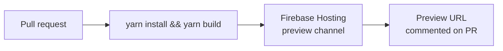
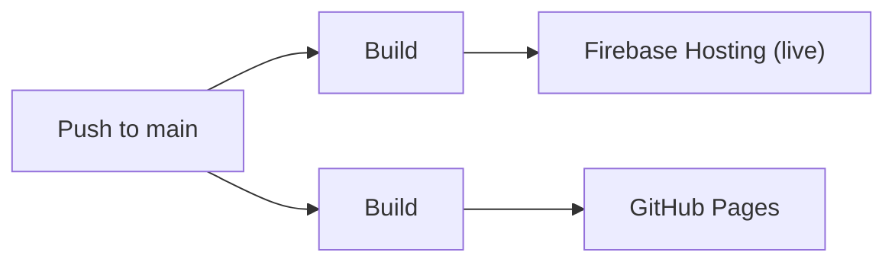
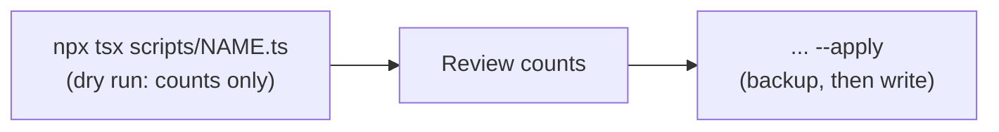
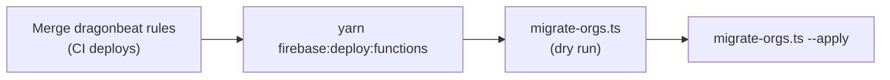

# Deployment

The app is a static build (`yarn build` → `build/`) deployed to two hosts by
GitHub Actions. Firestore security rules are deployed separately, from the
[`dragonbeat`](https://github.com/dyordsabuzo/dragonbeat) repo.

## Pull requests: Firebase Hosting preview

[`firebase-hosting-pull-request.yml`](.github/workflows/firebase-hosting-pull-request.yml)
builds every pull request from this repository and deploys it to a temporary
Firebase Hosting preview channel. The preview link is posted on the PR.

## Merge to `main`: production

Two workflows run on every push to `main`:

- [`firebase-hosting-merge.yml`](.github/workflows/firebase-hosting-merge.yml)
  deploys to the **live** Firebase Hosting channel.
- [`deploy-static-site.yml`](.github/workflows/deploy-static-site.yml) deploys
  the same build to **GitHub Pages**.

Both can also be started by hand (`workflow_dispatch`).

## Secrets

Repository secrets used by the workflows (values are never committed):

| Secret | Purpose |
| --- | --- |
| `VITE_FBASE_APIKEY`, `VITE_FBASE_AUTHDOMAIN`, `VITE_FBASE_PROJECTID`, `VITE_FBASE_APPID` | Firebase web config baked into the build |
| `PACKAGES_READ_TOKEN` | Installs `@dyordsabuzo/ui-components` from GitHub Packages |
| `FIREBASE_SERVICE_ACCOUNT_TRAINING_PLANNER_387200` | Deploys to Firebase Hosting |

## Manual deploys

| Command | Deploys |
| --- | --- |
| `yarn firebase:deploy` | Hosting only (builds first) |
| `yarn firebase:deploy:functions` | Cloud Functions in `functions/` (region `australia-southeast1`, set in `functions/src/index.ts`). Requires the Blaze plan. |

`firebase:deploy` is deliberately limited to Hosting so a deploy from this
repo can never overwrite the shared Firestore rules.

## Data migrations

One-off Admin SDK scripts live in `scripts/`. They target the emulator when
`FIRESTORE_EMULATOR_HOST` is set, and otherwise the real project using
Application Default Credentials (`gcloud auth application-default login`).
They write nothing unless `--apply` is passed, and save a JSON backup to
`scripts/backups/` first. Backups contain user data and are gitignored.

### `migrate-ids.ts` (id references)

This converts content references and progress keys from names to doc ids,
and gives every session group a stable id. Run it **in the same window as
deploying the app version that reads ids**, while no admin is editing
content:

1. Merge to `main` and wait for the Hosting deploy to finish.
2. `npx tsx scripts/migrate-ids.ts`, then check the counts.
3. `npx tsx scripts/migrate-ids.ts --apply`

The script can be re-run safely. A second run reports 0 changes.

### `migrate-orgs.ts` (organisations)

This puts the existing data into one org. It copies the content to
`orgs/{orgId}/...` with the same ids and leaves the top-level collections in
place. It creates a member for each `users` doc: the given owner becomes
`owner`, other admins become `trainer`, and everyone else becomes a `client`
whose granted `plans` become `assignedPlanIds`. Then it sets everyone's `orgs`
claim; the owner also gets `superAdmin`. To also update claims in the
emulator, set `FIREBASE_AUTH_EMULATOR_HOST`.

1. Merge the dragonbeat rules for `orgs/` and wait for its deploy.
2. `yarn firebase:deploy:functions`
3. `npx tsx scripts/migrate-orgs.ts --org-id=<id> --name="<org name>" --owner=<uid>`, then check the counts.
4. Run it again with `--apply`.

The script can be re-run safely. Existing members are left alone, and
content that is already copied is skipped.
