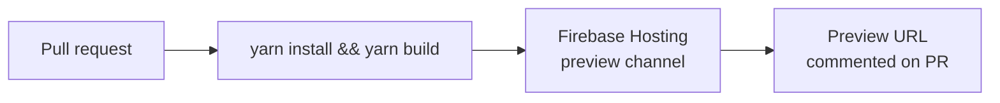
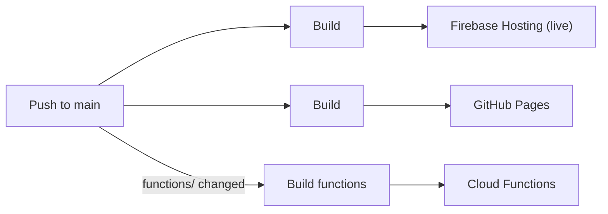
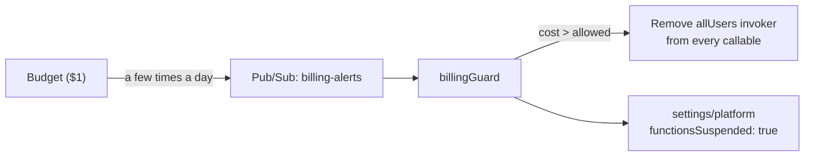
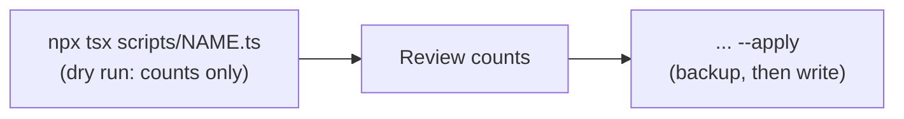
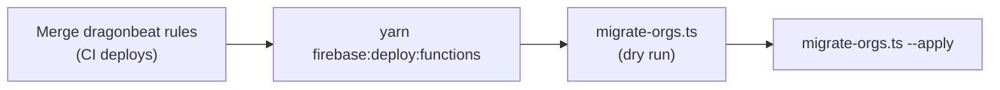
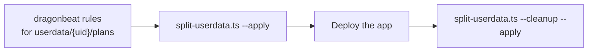

# Deployment

The app is a static build (`yarn build` → `build/`) deployed to two hosts by
GitHub Actions. Firestore security rules are deployed separately, from the
[`dragonbeat`](https://github.com/dyordsabuzo/dragonbeat) repo.

## Pull requests: Firebase Hosting preview

[`firebase-hosting-pull-request.yml`](.github/workflows/firebase-hosting-pull-request.yml)
builds every pull request from this repository and deploys it to a temporary
Firebase Hosting preview channel. The preview link is posted on the PR.



## Merge to `main`: production

Two workflows run on every push to `main`:

- [`firebase-hosting-merge.yml`](.github/workflows/firebase-hosting-merge.yml)
  deploys to the **live** Firebase Hosting channel.
- [`deploy-static-site.yml`](.github/workflows/deploy-static-site.yml) deploys
  the same build to **GitHub Pages**.

A third, [`deploy-functions.yml`](.github/workflows/deploy-functions.yml),
deploys **Cloud Functions** only when `functions/`, `firebase.json` or the
workflow itself changes.



All three can also be started by hand (`workflow_dispatch`).

## Secrets

Repository secrets used by the workflows (values are never committed):

| Secret | Purpose |
| --- | --- |
| `VITE_FBASE_APIKEY`, `VITE_FBASE_AUTHDOMAIN`, `VITE_FBASE_PROJECTID`, `VITE_FBASE_APPID` | Firebase web config baked into the build |
| `PACKAGES_READ_TOKEN` | Installs `@dyordsabuzo/ui-components` from GitHub Packages |
| `FIREBASE_SERVICE_ACCOUNT_TRAINING_PLANNER_387200` | Deploys to Firebase Hosting and Cloud Functions |

To deploy functions, the service account also needs these roles: Cloud
Functions Admin, Cloud Run Admin, Cloud Build Editor, Artifact Registry
Administrator, Service Account User and Firebase Viewer.

## Manual deploys

| Command | Deploys |
| --- | --- |
| `yarn firebase:deploy` | Hosting only (builds first) |
| `yarn firebase:deploy:functions` | Cloud Functions in `functions/` (region `australia-southeast1`, set in `functions/src/index.ts`). Requires the Blaze plan. |

`firebase:deploy` is deliberately limited to Hosting so a deploy from this
repo can never overwrite the shared Firestore rules.

## Cost controls

Cloud Functions are set up to cost nothing for normal use, and to stop
themselves once they start costing money.

- **Capped spend rate.** Every function runs as at most one small instance
  (`maxInstances: 1`, `cpu: "gcf_gen1"`, 256 MiB, 10 s timeout; see
  `functions/src/index.ts`). Extra concurrent calls are refused, not scaled out.
- **Kill switch.** A $1 Cloud Billing budget publishes to the Pub/Sub topic
  `billing-alerts`. `billingGuard` (`functions/src/guard.ts`) removes public
  access from every callable as soon as the month-to-date cost is above 0.
  It also sets `settings/platform.functionsSuspended`. Blocked calls are
  refused by Cloud Run before any instance runs. Hosting and Firestore keep
  working.



Billing data lags usage by hours, so some cost can still build up before
the guard fires. The capped spend rate keeps that small.

### One-time setup (done 2026-10-25)

This is already set up. It's recorded here in case the project needs to be
set up again. If your local `gcloud auth login` doesn't work, get a token from
your application-default login and pass it with `--access-token-file=/tmp/gtoken`:
`gcloud auth application-default print-access-token > /tmp/gtoken`.
APIs that bill to a quota project, such as Budgets, also need
`--billing-project=training-planner-387200`.

| What | Value |
| --- | --- |
| Guard service account | `billing-guard@training-planner-387200.iam.gserviceaccount.com` |
| Its roles | custom `runInvokerPolicyAdmin` (`run.services.getIamPolicy`, `run.services.setIamPolicy`), `roles/datastore.user`, `roles/eventarc.eventReceiver` |
| Deploy service account | `github-action-642560285@…` (`FIREBASE_SERVICE_ACCOUNT_TRAINING_PLANNER_387200`), with Eventarc Admin and Pub/Sub Admin added |
| Service agents (needed by the Firebase CLI for Pub/Sub triggers) | Pub/Sub agent `service-659190863445@gcp-sa-pubsub…` → `roles/iam.serviceAccountTokenCreator`; default compute SA → `roles/run.invoker` and `roles/eventarc.eventReceiver` |
| Pub/Sub topic | `billing-alerts` |
| Budget | "training-planner cost guard": 1 AUD on billing account `01B296-8CABCA-583CE6`, scoped to this project, sends to `billing-alerts` |

These project-level invoker grants are for specific service accounts only.
The guard removes public (`allUsers`) access, so they don't weaken it.

### Resuming after a suspension

When the guard fires:
- every callable stops accepting public calls (Cloud Run refuses them)
- `settings/platform.functionsSuspended` is `true`, and `costAmount` holds the
  month-to-date cost that tripped it
- the function logs show `Billing guard: … callables suspended.`

To reopen:

1. Check what it cost (Billing → Reports) and decide how much more you
   accept this month.
2. Dry run, which shows the recorded cost and the current state:
   ```
   GOOGLE_CLOUD_QUOTA_PROJECT=training-planner-387200 npx tsx scripts/resume-functions.ts
   ```
3. Reopen, accepting a month-to-date cost of up to that amount (it must be
   at least the current cost):
   ```
   GOOGLE_CLOUD_QUOTA_PROJECT=training-planner-387200 npx tsx scripts/resume-functions.ts --allow-up-to=2 --apply
   ```
   It writes the allowance first and then gives `allUsers` invoker access
   back on each callable.

The allowance only lasts until the end of the billing month. After that the
guard trips again on the first cent. To keep functions off, just don't
resume them. A later functions deploy may make them public again, but the
guard closes them on the next budget notification.

## Data migrations

One-off Admin SDK scripts live in `scripts/`. They target the emulator when
`FIRESTORE_EMULATOR_HOST` is set, and otherwise the real project using
Application Default Credentials (`gcloud auth application-default login`).
With user credentials, also set
`GOOGLE_CLOUD_QUOTA_PROJECT=training-planner-387200`, or run
`gcloud auth application-default set-quota-project training-planner-387200`
once. Otherwise Auth and Cloud Run API calls fail with `auth/internal-error`.
They write nothing unless `--apply` is passed, and save a JSON backup to
`scripts/backups/` first. Backups contain user data and are gitignored.



### `check-org-codes.ts` (read-only)

Lists every org's code and flags duplicates or missing codes. Orgs are found
by code when sharing library items (`findOrgByCode`), so each code must be
unique. Writes nothing. On 2026-10-26 production had one org (`default`,
code `DEFAUL`) and no problems.

```
GOOGLE_CLOUD_QUOTA_PROJECT=training-planner-387200 npx tsx scripts/check-org-codes.ts
```

### `migrate-ids.ts` (id references)

This converts content references and progress keys from names to doc ids,
and gives every session group a stable id. Run it **in the same window as
deploying the app version that reads ids**, while no admin is editing
content:

1. Merge to `main` and wait for the Hosting deploy to finish.
2. `npx tsx scripts/migrate-ids.ts`, then check the counts.
3. `npx tsx scripts/migrate-ids.ts --apply`

The script can be re-run safely. A second run reports 0 changes.

### `migrate-orgs.ts` (organisations)

This puts the existing data into one org. It copies the content to
`orgs/{orgId}/...` with the same ids and leaves the top-level collections in
place. It creates a member for each `users` doc: the given owner becomes
`owner`, other admins become `trainer`, and everyone else becomes a `client`
whose granted `plans` become `assignedPlanIds`. Then it sets everyone's `orgs`
claim; the owner also gets `superAdmin`. To also update claims in the
emulator, set `FIREBASE_AUTH_EMULATOR_HOST`.



1. Merge the dragonbeat rules for `orgs/` and wait for its deploy.
2. `yarn firebase:deploy:functions`
3. `npx tsx scripts/migrate-orgs.ts`, then check the counts. It defaults to org `default` ("Default org"), owned by the production admin. Override with `--org-id=`, `--name=` and `--owner=`.
4. Run it again with `--apply`.

The script can be re-run safely. Existing members are left alone, and
content that is already copied is skipped.

### `cleanup-top-level.ts` (remove pre-org data)

This deletes the top-level `exercises`, `supersets`, `sessions` and `plans`,
strips `role` and `plans` from `users` docs, and drops
`settings/app.contentVersion`. If any top-level doc has no copy in the org,
it stops without changing anything. Run it only after:

1. the dragonbeat rules that use the `superAdmin` claim (and no longer allow
   the top-level collections) are deployed, and
2. the app version that stops writing `role` / `plans` is deployed.

```
GOOGLE_CLOUD_QUOTA_PROJECT=training-planner-387200 npx tsx scripts/cleanup-top-level.ts          # dry run
GOOGLE_CLOUD_QUOTA_PROJECT=training-planner-387200 npx tsx scripts/cleanup-top-level.ts --apply
```

### `split-userdata.ts` (progress per plan)

This moves each plan's progress out of `userdata/{uid}` into
`userdata/{uid}/plans/{planId}`, tagged with the plan's org (looked up from
`orgs/*/plans`, else `--org-id`, default `default`). The copy fills in only
runs a plan doc doesn't have yet, so it never overwrites runs the new app has
saved. `--cleanup` copies once more, then removes the plan entries from
`userdata/{uid}` and keeps `inProgress`.



```
GOOGLE_CLOUD_QUOTA_PROJECT=training-planner-387200 npx tsx scripts/split-userdata.ts                     # dry run
GOOGLE_CLOUD_QUOTA_PROJECT=training-planner-387200 npx tsx scripts/split-userdata.ts --apply
GOOGLE_CLOUD_QUOTA_PROJECT=training-planner-387200 npx tsx scripts/split-userdata.ts --cleanup --apply   # after the app is live
```

The copy was applied to production on 2026-10-25 (3 plan docs, all in org
`default`). Run the cleanup once the new app is confirmed working. A run
deleted between the copy and the cleanup comes back, since the cleanup copies
again first.
